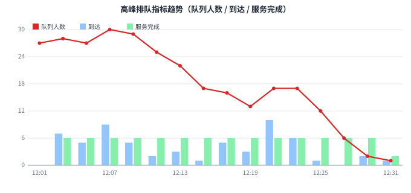

# 课题04 排队吞吐率分析报告

- 采样窗口：12:01 — 12:31，每 2 分钟记录一次，共 16 组
- 有效观测时长：30 分钟；服务台数量：3

## 核心指标

| 指标 | 数值 | 含义 |
|---|---|---|
| 总到达人数 | 60 人 | 窗口内到达总量 |
| 总服务完成 | 86 人 | 窗口内完成服务离开总量 |
| 到达率 λ | 2.00 人/分 | 平均每分钟新到顾客数 |
| 系统吞吐 | 2.87 人/分 | 平均每分钟能服务完的人数 |
| 平均队列长度 L | 18.1 人 | 系统内平均人数（含正被服务者）|
| 平均单次服务耗时 | 60 秒 | 抽样的服务台忙时均值 |
| 单服务台服务率 μ | 1.00 人/分 | 60 / 平均单次服务耗时 |
| 服务台利用率 ρ | 67% | λ / (服务台数 × μ)，>85% 视为饱和 |
| 平均停留时间 W | 9.0 分钟 | Little 定律：L = λ × W；系统内停留，含约 1 分钟服务 |
| 平均排队等待 Wq | 8.0 分钟 | W − 平均单次服务耗时（60 秒），即纯排队时间 |
| 队列增长斜率 | -0.94 人/分钟 | >0.2 视为持续增长（不稳定）|
| 队列峰值 | 30 人 | 观测到的最大队长 |

## 积压时段（到达 > 服务完成）

- 12:03：到达 7 人，完成 6 人，净积压 +1 人
- 12:07：到达 9 人，完成 6 人，净积压 +3 人
- 12:21：到达 10 人，完成 6 人，净积压 +4 人

## 瓶颈判定

- **观测窗口处于高峰后的衰减段**：队列由 27 人降至 1 人（净减 26 人），到达率持续低于系统吞吐——说明采样开始前高峰已把队列堆到 27 人，真正的瓶颈发生在观测窗口之前，需结合供餐节奏判断高峰起点。

## 低成本改进方案（百元预算内）

1. 压缩单次服务耗时（当前均值 60 秒）：预置常用选项、扫码预点餐/预约，把点单与取餐分离；
2. 排队区管理：明确队列标识与预计等待时间提示，降低插队与弃队（弃队等于白排队，进一步浪费服务能力）。

### 针对本点位的具体措施（结合现场照片与数据）

观测点位：食堂"科学选餐"广式碟头饭窗口（菜单编号 19/21），现场同框照 `photos/site_01.jpg`、`photos/site_02.jpg`。

1. **高峰前预出餐（零成本）**：12:01 开始观测时队列已达 27 人、12:07 冲到 30 人，说明积压形成于 11:50 前后。档口可在 11:45 前把菜单前几项高频菜品（鸡扒饭、辣子鸡饭、梅菜肉饼饭）预分装到餐盘，直接削减"打饭"环节耗时——按 60 秒/人测算，每省 15 秒，30 人积压的消化时间从 10 分钟缩到 7.5 分钟；
2. **设"只取餐"快速通道（零成本）**：预点餐/现场预订的同学凭取餐码到窗口侧位直接取餐，绕开点单沟通环节（估 20 秒）。照片显示窗口为单一队列，侧位取餐不与主队列冲突；
3. **等待时间可见化（成本 <10 元）**：队列上方放小白板，按"队列人数 × 60 秒 ÷ 3 个服务台"手写当前预计等待时间。观测显示平均停留 9 分钟，等待不可见时弃队率高——弃队者白排队，其占用的服务能力也被浪费。

### 数据说明

- 到达 60 人 < 服务完成 86 人，队列 27→1 人持续下降：观测窗口（12:01–12:31）捕捉到的是**高峰过后的衰减段**，瓶颈（27+ 人积压）形成于观测开始之前；
- 单次服务耗时 60 秒为单人抽样值，现场备注确认该窗口有 3 名打饭员并行，故服务台数取 3；
- 口径说明：W 由 Little 定律 L = λ × W 从实测 L、λ **换算**得到（18.1 ÷ 2.0 ≈ 9.0），属换算口径而非独立校验；本数据真正的自校验是逐间隔恒等式"队列变化 = 到达 − 完成"，15 个间隔全部通过，且全窗口物料平衡成立（12:01 队列 27 + 到达 60 − 完成 86 = 12:31 队列 1）；
- 引用边界：W = 9.0 分钟是**观测窗口内到达者**的系统内平均停留（含约 1 分钟服务，纯排队约 8.0 分钟）。窗口处于高峰后的衰减段（队列 27 → 1），早期到达者等待约 10 分钟、晚期约 2 分钟，该值为混合平均，引用时须注明窗口 12:01–12:31；

## 队列趋势图

